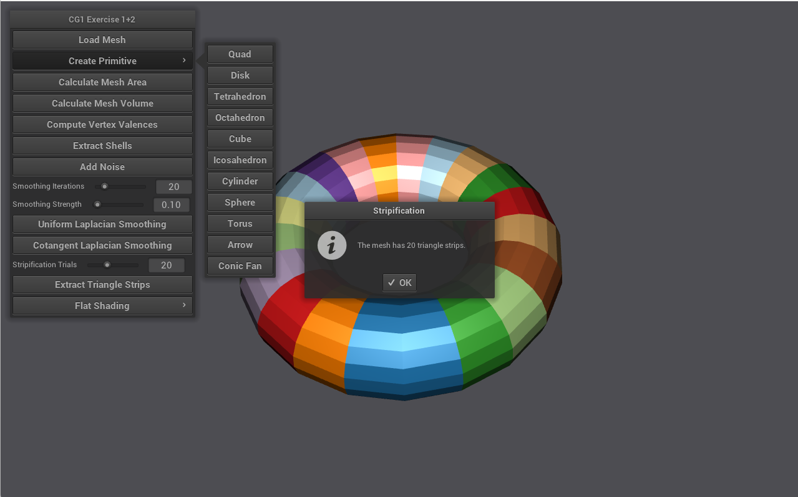
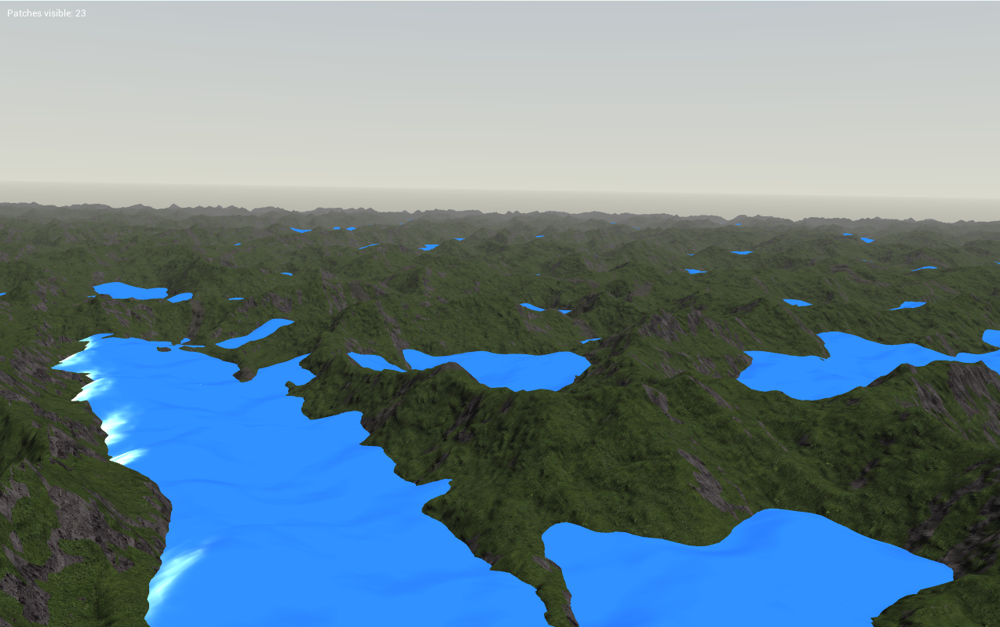
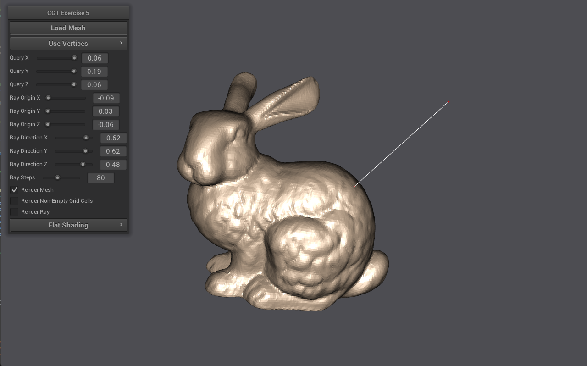

# CG1-Exercises
Building upon the CGV-Framework to gather knowledge about computer graphics 
- The framework provided the main functionality of the program, so our work was to implement the taks specified modules
- This was divided into 5 different excercises on C++ and GLSL

## Exercises
### Exercise 1 & 2
It focus is mainly on polygon mesh processing 
- We had to render the primitives 
- Calculate their area, volume and vertex valences
- Afterwards, extract their shells and triangle strips
- Implement Uniform/Cotangent Laplacian Smoothing

### Exercise 4
Infinite terrain
- Map a terrain/normal texture onto the mesh
- Path texture is super imposed
- Steep slopes have a *stone* color 
- Water is added in shader code for efficiency (Sinusoidal implementation with specular light)

### Exercise 5 
Acceleration Datastructures
- Implement bounding boxes (AABB trees from vertices/edges/triangles)
- Then calculate what is the closest point from arbitrary point to the mesh

